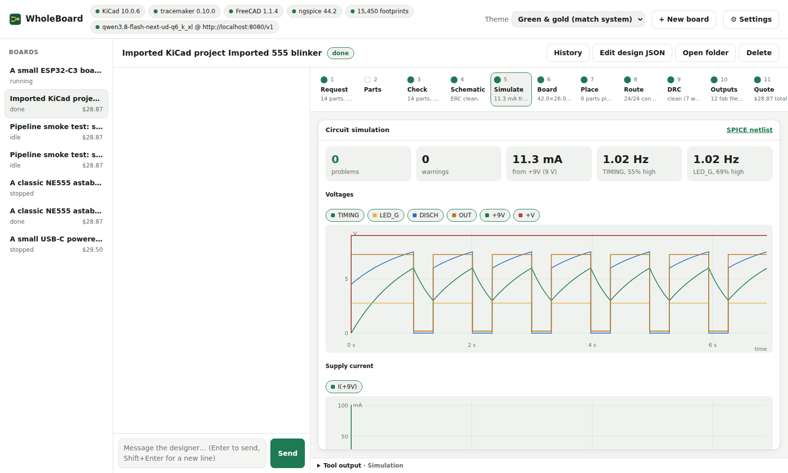
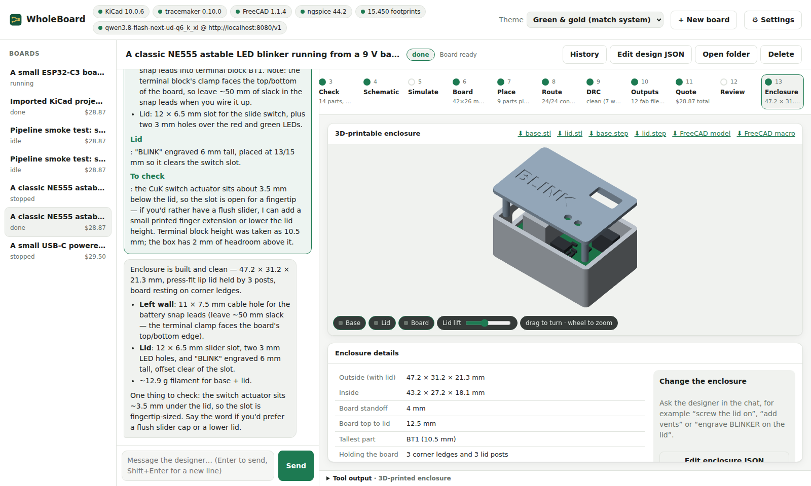

# WholeBoard

> **🚧 Under construction.** WholeBoard is in active development. Expect rough edges, breaking
> changes and boards that need a human check before you order them.

An AI workbench for printed circuit boards. Describe the board you want in plain words.
WholeBoard's designer agent asks you what it needs to know, picks real JLCPCB parts and KiCad
footprints, writes the schematic and board, has **TraceMaker** place and route it, checks it with
**KiCad's** design rule check and **ngspice**, and prices the whole job at **JLCPCB**: bare PCB,
assembly, every component and shipping. It then designs a 3D-printable enclosure for the board in
**FreeCAD**. Each step shows a visual you can inspect.

Runs on Linux, macOS and Windows. It is a local web app: the server runs on your machine and the
interface opens in your browser.

**Documentation: <https://dingooz.github.io/WholeBoard/>**






## Quick start

```
./install.sh        # Linux and macOS; on Windows, double-click install.bat
./run.sh            # or run.bat; the browser opens at http://127.0.0.1:8770/
```

The installer sets up Python, KiCad, TraceMaker, FreeCAD, ngspice and KiCad's libraries, asking
before it installs system packages. `.venv/bin/python -m wholeboard.doctor` shows what is installed.
Set an AI in *Settings*: Claude, OpenAI, Grok, or a local model through any OpenAI-compatible
server. Then press **Take a tour**, or follow [Your first board](https://dingooz.github.io/WholeBoard/tutorials/first-board/).

## What it does

- **Designs from proven building blocks**: USB-C power and PD, regulators, ESP32, RP2040, STM32
  and nRF52 modules, Ethernet, CAN, RS-485, sensors and more, with real LCSC parts.
- **Checks before you order**: ERC, ngspice simulation and part ratings, power budget, KiCad DRC
  against JLCPCB's limits, IPC-2152 trace heating, voltage drop, decoupling, controlled impedance
  with USB/Ethernet/RMII/QSPI/RF interface profiles, and mains creepage and clearance with
  isolation slots.
- **Shows the simulation on the 3D board**: current flow, LED brightness, a heat map, the board in
  its enclosure, and sliders that re-run ngspice.
- **Prices the job**: JLCPCB with live part prices, cheaper drop-in parts, panels drawn with KiKit,
  Mouser and DigiKey for parts JLCPCB cannot fit, OSH Park, PCBWay and Aisler for comparison.
- **Gets it built**: Gerbers, BOM and CPL, an assembly page, a bring-up guide, starter firmware
  with a pin map, and a 3D-printed enclosure with its heat checked.
- **Works with what you have**: import KiCad projects, keep your edits in KiCad, fit a board to a
  DXF outline or a box you already own, and use the checks from other agents over MCP.

## Documentation

| | |
|---|---|
| [Tutorials](https://dingooz.github.io/WholeBoard/tutorials/) | Your first board; a mains-powered board |
| [How-to guides](https://dingooz.github.io/WholeBoard/how-to/) | Install, import, panels, ordering, firmware, MCP, the benchmark, your own blocks |
| [Reference](https://dingooz.github.io/WholeBoard/reference/) | The design spec, blocks, profiles, mains figures, checks, settings, the Python API |
| [Explanation](https://dingooz.github.io/WholeBoard/explanation/) | How a build works, how rules reach the router, the heat models, the two AI models |
| [Standards and sources](https://dingooz.github.io/WholeBoard/standards/) | Every engineering figure and price, where it comes from and when it was checked |

The source is in [`docs/`](docs/); `mkdocs serve` previews it (see
[Development](https://dingooz.github.io/WholeBoard/development/)). Changes are listed in
[CHANGELOG.md](CHANGELOG.md).

## Licence

WholeBoard is free software under the GNU General Public License, version 3 or later. See
[LICENSE](LICENSE).
