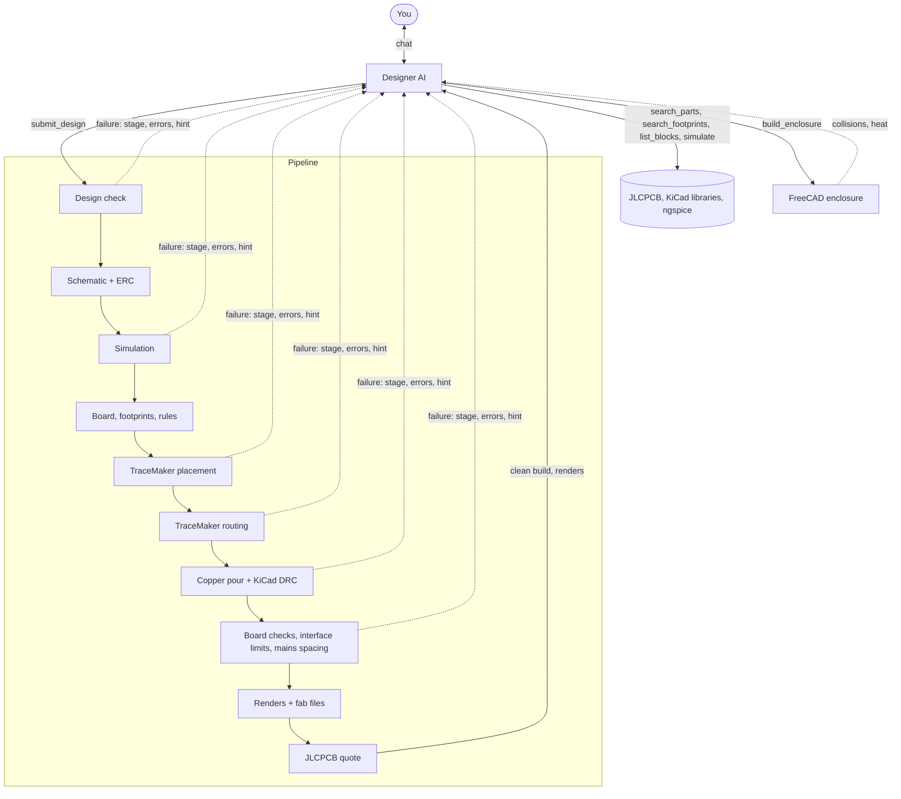

# How a build works

WholeBoard has two halves. The **designer** is an AI with tools: it talks to you, searches parts and footprints,
and writes the design, a JSON document ([Design spec](../reference/spec.md)). The **pipeline** is ordinary code:
it turns a design into a KiCad project, routes it, checks it and prices it. The designer never edits KiCad files;
it only ever submits a complete design, and the pipeline builds it from scratch (keeping
[your KiCad edits](../how-to/kicad-edits.md)).

## What stops a build

Each stage that can fail returns a result with the stage name, the errors and often a hint, such as "move the
parts apart, or use parts with wider pin spacing". The designer reads it, changes the design and submits again.
The stages that stop a build:

- **Design check**: missing footprints, wrong pad names, unconnected pads, a mains design without a fuse or barrier.
- **Simulation**: an overloaded part or a failed expectation. It runs before the board is drawn because it takes
  seconds and catches wrong values early; the designer can also call `simulate` before submitting.
- **Placement**: parts that do not fit.
- **Routing**: connections left open.
- **DRC**: any error.
- **Mains spacing**: any pair across the barrier too close.

Warnings (ERC findings, trace heating, voltage drop, interface limits) are shown with the build and given to the
designer, which fixes the ones that matter.

After three failures in a row, the [expert model](models.md) (if set up) is asked what is going wrong.

## Why the design is JSON

- A complete design in one document can be rebuilt from scratch, compared between revisions and restored.
- The AI cannot leave a KiCad file half-edited.
- You can edit the design yourself (*Edit design JSON*) and rebuild without the AI.
- Checks read the same document: the simulation, the mains sides, the interface profiles and the quote all start
  from the spec, not from KiCad files.

## Revisions

Every build goes in a new `revN` folder. Nothing is overwritten, so *History* can show what changed between any two
builds and *Restore* can bring an old one back as a new revision.
