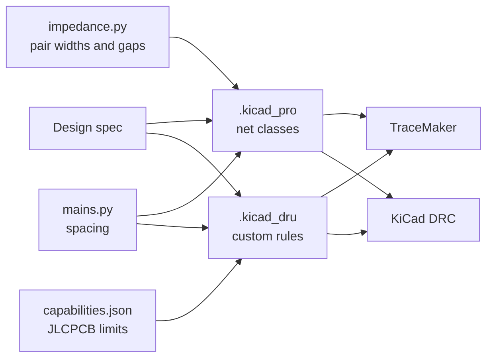

# How rules reach the router and DRC

A rule that only the DRC knows about is found after routing, and the board has to be routed again. So WholeBoard
writes every rule once, into KiCad's own files, and every tool reads them from there.

| Source | Written to | What |
|---|---|---|
| `rules` in the design | `.kicad_pro` default net class | Track width, clearance, via size |
| Nets with `class: "power"` | `Power` net class | Wider tracks |
| `impedance` | A net class per group | Width and pair gap for the impedance on JLCPCB's stack-up |
| `mains` | `Mains` and `Mains side` net classes, `.kicad_dru` rules | Functional spacing between mains nets; reinforced clearance and creepage to everything else |
| `capabilities.json` | `.kicad_dru` | JLCPCB's annular rings, hole spacing, hole to copper, edge clearance, silkscreen, aspect ratio |

TraceMaker reads a board's sibling `.kicad_pro` and `.kicad_dru`, including rules with conditions on net classes.
So both files are copied next to every intermediate board TraceMaker works on, not only the final one
([decision 4](../decisions/0004-rules-beside-every-board.md)).

## Where KiCad falls short

- **Creepage.** KiCad 10's DRC understands `(constraint creepage …)`, but the zone filler does not: a ground pour
  fills right up to the clearance and then fails creepage. So for surface copper WholeBoard also writes a clearance
  rule equal to the creepage distance ([decision 3](../decisions/0003-surface-rule-for-creepage.md)), and measures
  creepage itself after DRC.
- **Interface limits.** Length matching, skew between pairs and stubs are checked by WholeBoard after routing
  (`impedance.check`), not by KiCad.
