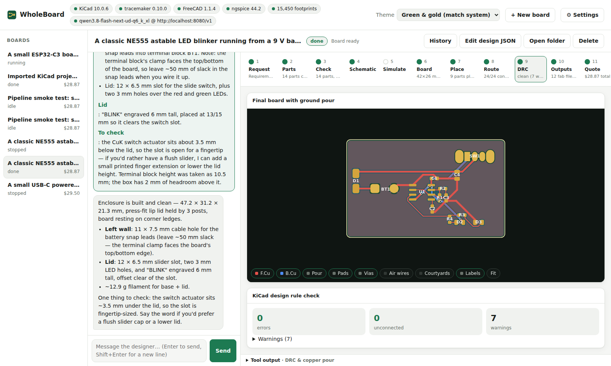

# WholeBoard

An AI workbench for printed circuit boards. Describe the board you want in plain words. WholeBoard's designer
asks what it needs to know, picks real JLCPCB parts and KiCad footprints, writes the schematic and board, has
**TraceMaker** place and route it, checks it with **KiCad's** design rule check and **ngspice**, and prices the
whole job at **JLCPCB**. It then designs a 3D-printable enclosure for the board in **FreeCAD**. Each step shows a
visual you can inspect.

!!! warning "Under construction"
    WholeBoard is in active development. Expect rough edges, breaking changes and boards that need a human check
    before you order them.

-   :material-school: **[Tutorials](tutorials/index.md)**

    Build your first board from a sentence, then a mains-powered one.

-   :material-tools: **[How-to guides](how-to/index.md)**

    Install, import a KiCad project, make a panel, order, flash, use the checks from other agents.

-   :material-book-open-variant: **[Reference](reference/index.md)**

    The design spec, building blocks, interface profiles, mains figures, checks, settings and the Python API.

-   :material-lightbulb-on: **[Explanation](explanation/index.md)**

    How a build works, how rules reach the router, the heat models and the two AI models.

## What it uses

| Tool | What for |
|---|---|
| [KiCad](https://www.kicad.org/) 9 or 10 | Libraries, schematic and board files, ERC, DRC, zone fill, renders, fab outputs |
| [TraceMaker](https://github.com/DingoOz/TraceMaker) | Placement and routing |
| [ngspice](https://ngspice.sourceforge.io/) | Circuit simulation |
| [FreeCAD](https://www.freecad.org/) 1.0+ | Enclosures |
| [KiKit](https://github.com/yaqwsx/KiKit) (optional) | Panels |
| [PlatformIO](https://platformio.org/) (optional) | Compiling the starter firmware |
| An AI | Claude, OpenAI, Grok, or a local model through any OpenAI-compatible server |

Also: [Standards and sources](standards.md) lists every engineering figure WholeBoard relies on, and
[Decisions](decisions/index.md) records why things are the way they are.
