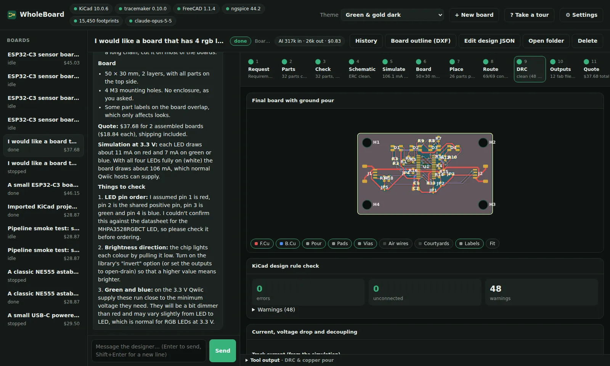
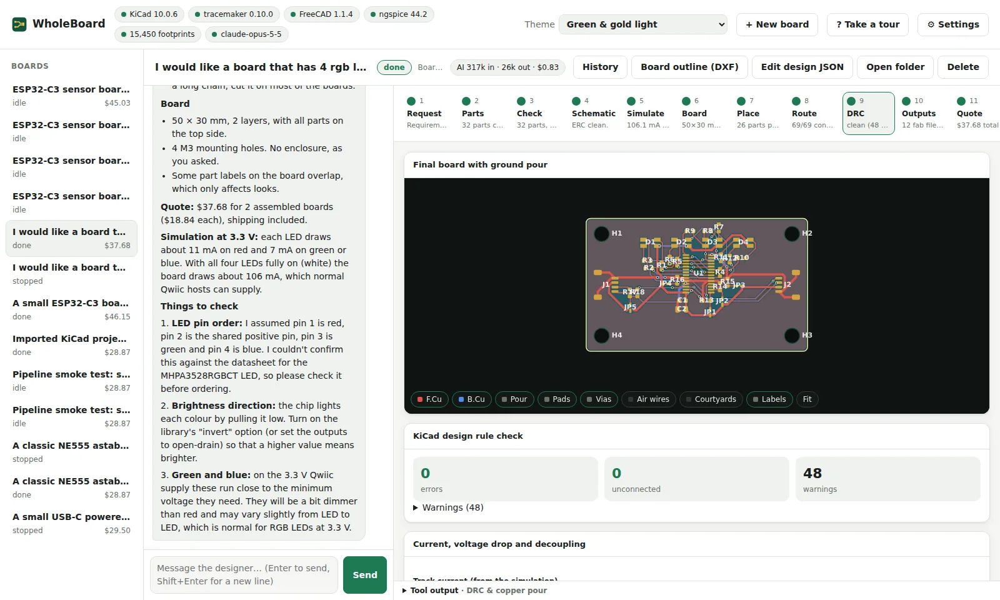
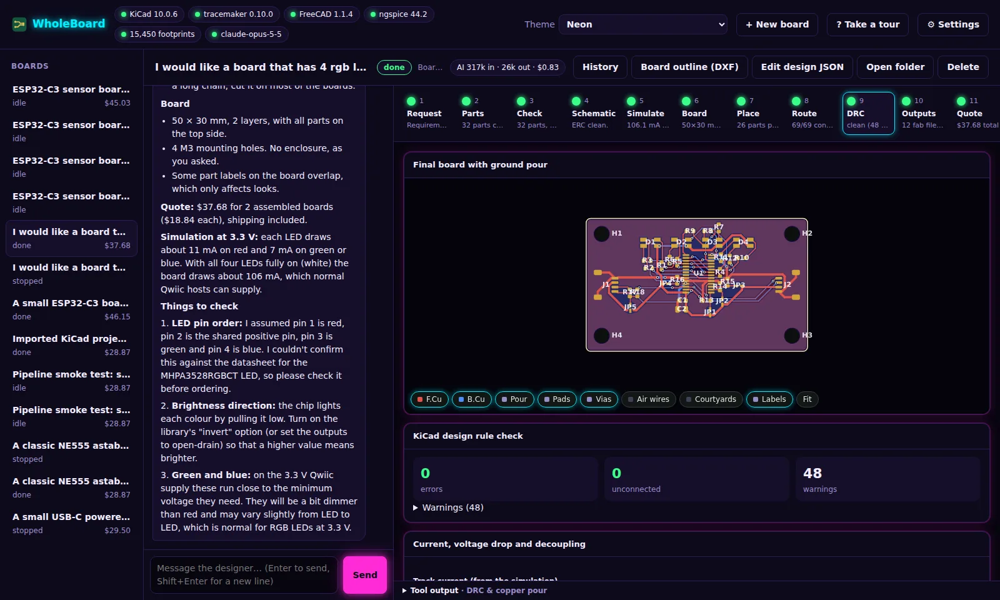
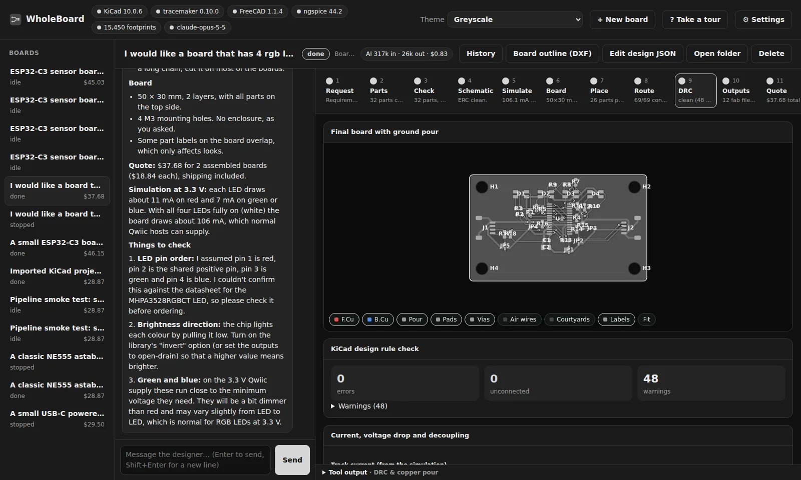
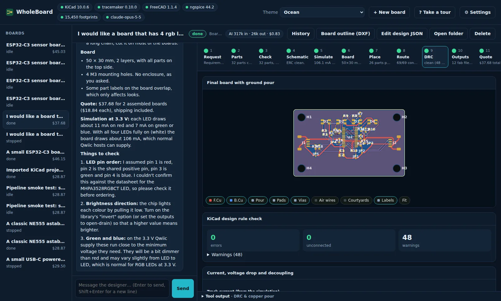
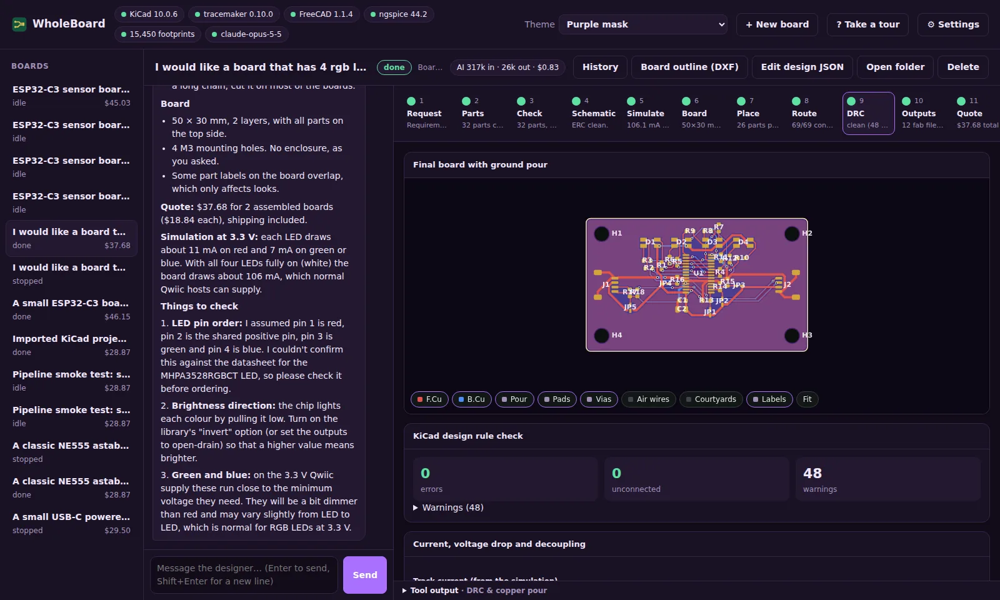
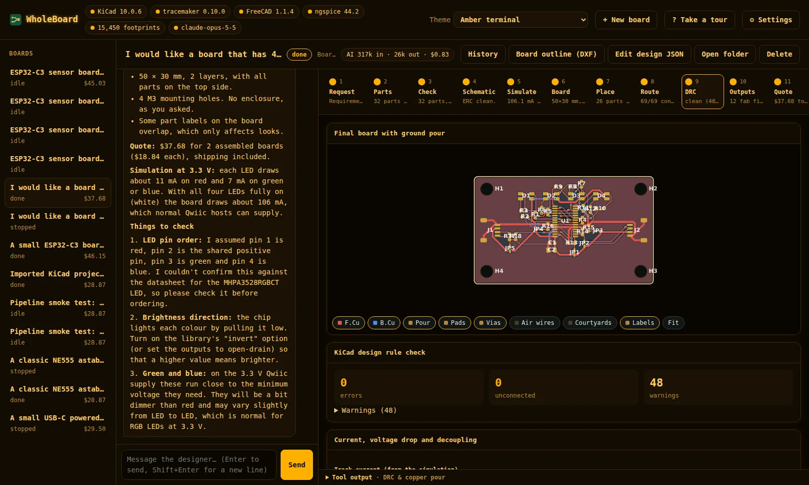
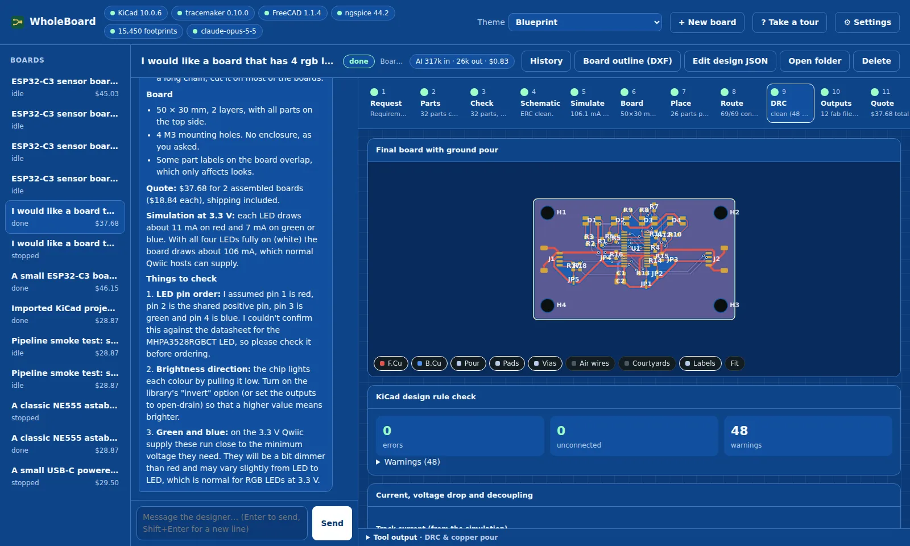
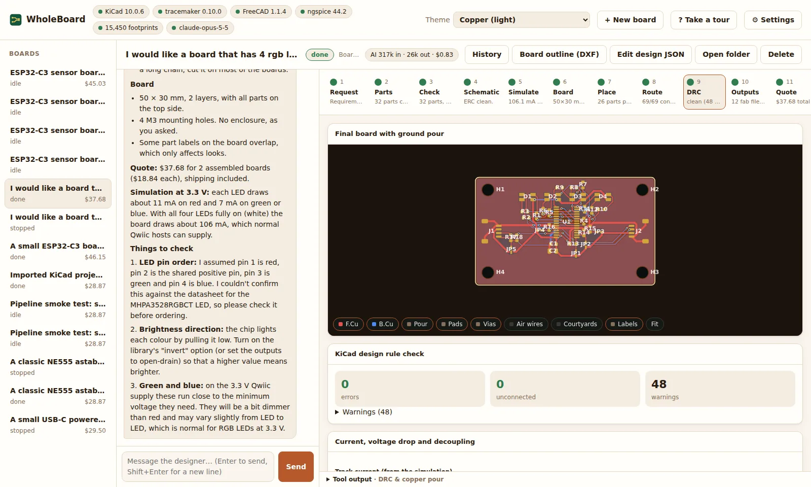
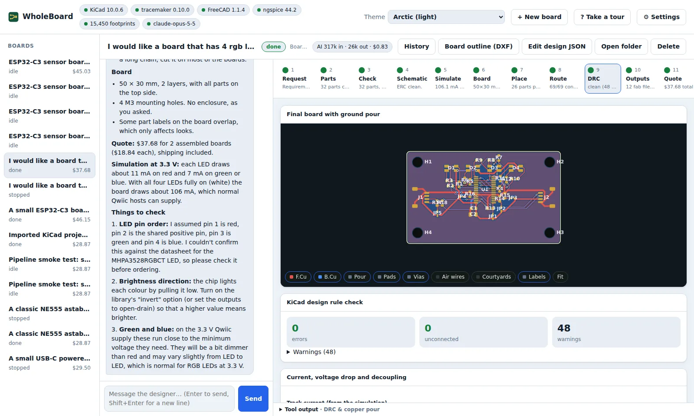

# Colour themes

Pick a theme from the **Theme** menu at the top of the window. The choice is saved in your browser, so each
computer (and each browser) keeps its own. The board drawing, plots, the 3D views and the Sim Lab redraw in the new colours straight away.

Every screenshot below shows the same finished board on its *DRC & copper pour* step.

| Theme | Light or dark | |
|---|---|---|
| Green & gold (match system) | Follows your system | The default: the dark or light green & gold theme, whichever your system uses |
| [Green & gold dark](#green-gold-dark) | Dark | |
| [Green & gold light](#green-gold-light) | Light | |
| [Neon](#neon) | Dark | Hot pink and cyan, with glow |
| [Greyscale](#greyscale) | Dark | No colour anywhere, pictures included |
| [Ocean](#ocean) | Dark | Deep navy with teal and coral |
| [Purple mask](#purple-mask) | Dark | The solder-mask colour, with yellow silkscreen |
| [Amber terminal](#amber-terminal) | Dark | A retro phosphor screen in a monospaced font |
| [Blueprint](#blueprint) | Dark | Drafting-paper blue with a grid |
| [Copper](#copper) | Light | Warm, with a copper-brown board |
| [Arctic](#arctic) | Light | Cool and crisp |

## Green & gold dark

{ loading=lazy }

## Green & gold light

The board itself stays dark, so the copper and silkscreen read the same as in the dark theme.

{ loading=lazy }

## Neon

{ loading=lazy }

## Greyscale

Images, the board and the 3D views are shown in grey too, and errors are underlined so they don't rely on colour.

{ loading=lazy }

## Ocean

{ loading=lazy }

## Purple mask

{ loading=lazy }

## Amber terminal

{ loading=lazy }

## Blueprint

{ loading=lazy }

## Copper

{ loading=lazy }

## Arctic

{ loading=lazy }

## Adding a theme

Themes are in [`wholeboard/web/themes.css`](https://github.com/DingoOz/WholeBoard/blob/main/wholeboard/web/themes.css).
Each one is a `:root[data-theme="name"]` block that sets every colour token used by `style.css`:

| Token | Used for |
|---|---|
| `--bg`, `--panel`, `--panel-2`, `--line` | Page background, cards, inset areas, borders |
| `--text`, `--muted` | Text and secondary text |
| `--accent`, `--accent-2`, `--on-accent` | Buttons and highlights, the second highlight colour, text on an accent |
| `--ok`, `--warn`, `--danger`, `--info` | Status colours |
| `--board-bg`, `--board-mask` | Behind the board drawing, and the solder mask |
| `--shadow`, `color-scheme` | Card shadow; `dark` or `light` for form controls and scroll bars |

Copy an existing block, change the colours, and add an `<option>` with the same name to the `themeSelect` menu in
[`wholeboard/web/index.html`](https://github.com/DingoOz/WholeBoard/blob/main/wholeboard/web/index.html).
Extra rules such as Neon's glow can follow the block, scoped with `[data-theme="name"]`.
